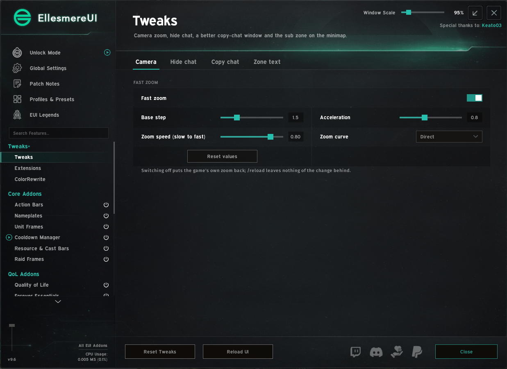
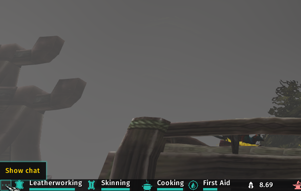
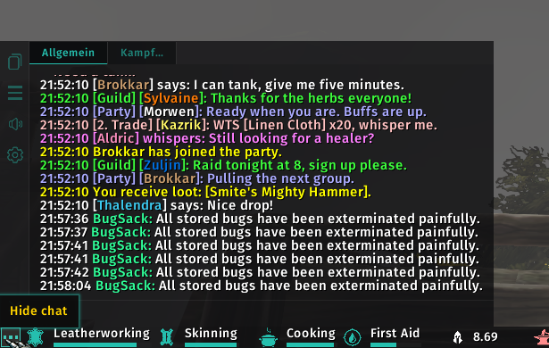
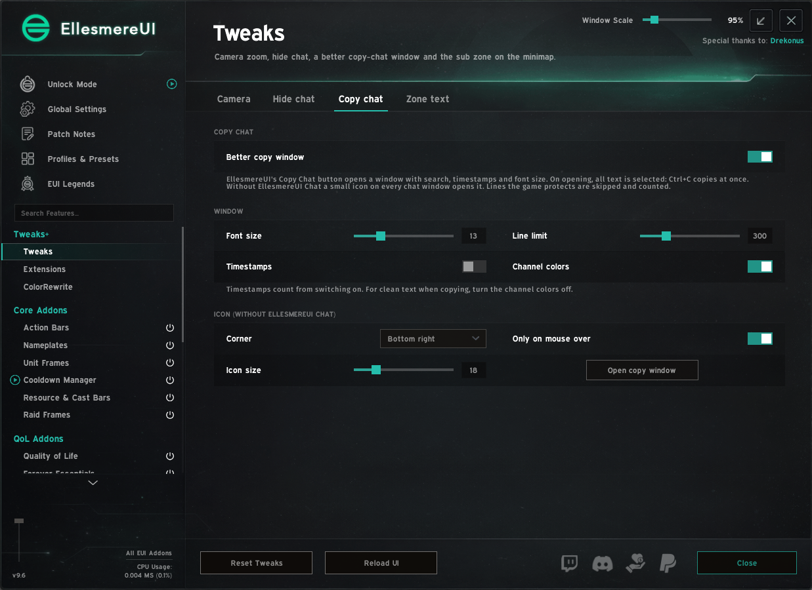
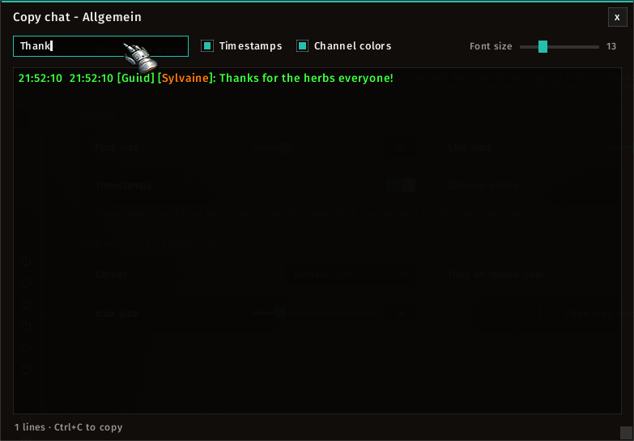
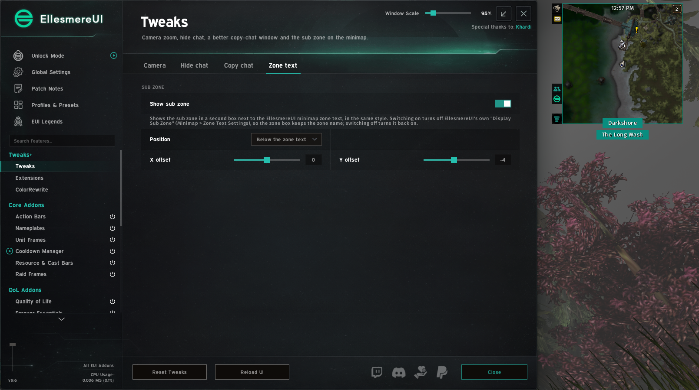
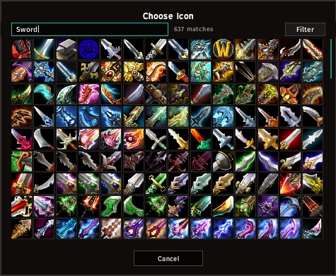
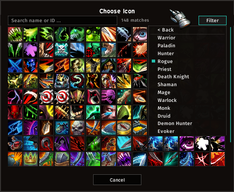
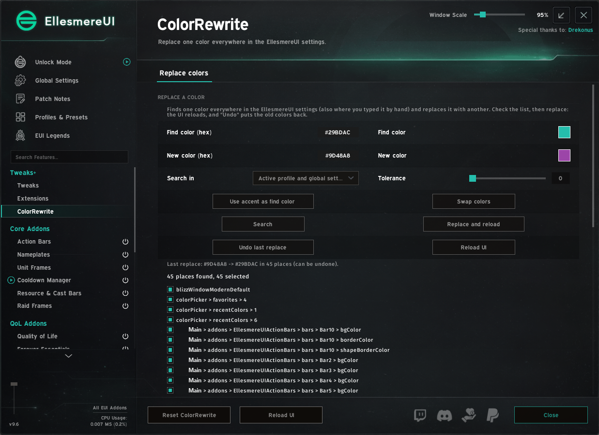

# EUI Tweaks

Extra tweaks for EllesmereUI on WoW: Forever. An unofficial add-on for EllesmereUI; it needs EllesmereUI and puts
its options into the EllesmereUI panel (section **Tweaks+**).

## Features

- **Tweaks > Camera:** fast mouse-wheel zoom. Turn the wheel quickly to cover much more distance, slowly for small
  steps. Base step, acceleration, speed and curve can be set.
- **Tweaks > Hide chat:** one button hides the chat windows, tabs, input box and chat buttons (with EllesmereUI Chat
  also its background and sidebar). Enter or Edit Mode bring the chat back. The button uses the EllesmereUI accent
  color, or any color you pick.
- **Tweaks > Copy chat:** EllesmereUI's Copy Chat button opens a window with search, timestamps, channel colors and font
  size. On opening all text is selected, so Ctrl+C copies at once.
- **Tweaks > Zone text:** the sub zone in a second box next to the EllesmereUI minimap zone text, in the same style,
  with position and X/Y offset.
- **Extensions > Icon search:** a search line and a category filter (classes, weapons, armor, magic, professions ...)
  in EllesmereUI's macro "Choose Icon" window. The icon data loads only when the window opens.
- **Tweaks > Window reset:** a key binding (Key Bindings › AddOns › EUI Tweaks) puts the window under the mouse back to
  its default position and zoom, like "Reset Specific Window" of EllesmereUI's Shifter. It asks first unless you
  switch that off.
- **ColorRewrite:** find one color (for example `#29BDAC`) everywhere in the EllesmereUI settings, also where you
  typed it by hand, and replace it with another. The list shows every place first; the last replace can be undone.

Every function is off until you switch it on. `/eut` opens the options.

## Install

Copy the `EUITweaks` and `EUITweaks_Icons` folders into `World of Warcraft\_forever_\Interface\AddOns`
(WoW: Forever), or install through CurseForge.

## Notes

Requires EllesmereUI. Not affiliated with EllesmereUI or its author.

## License

MIT, see `LICENSE`. The icon data in `EUITweaks_Icons` is public domain (see the LICENSE in that folder).
